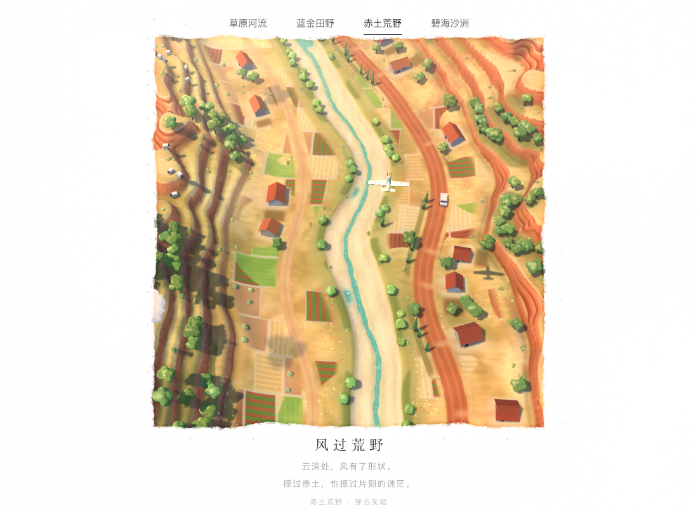
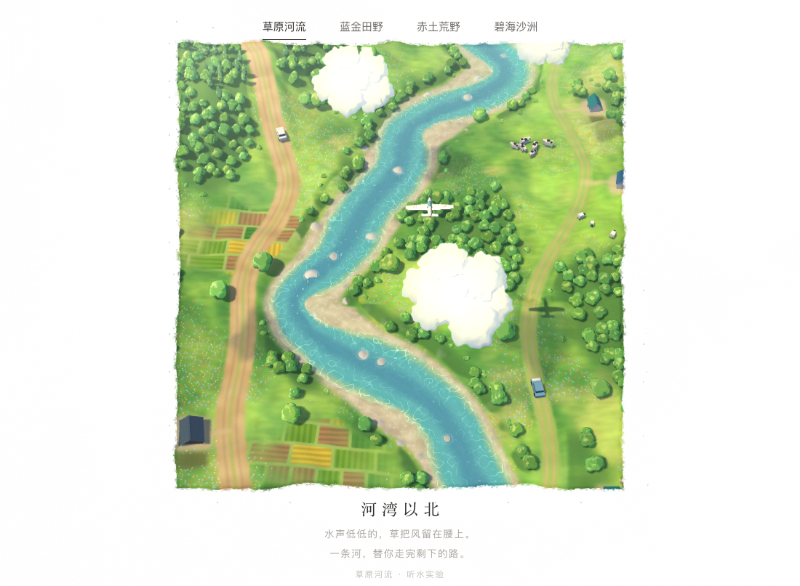
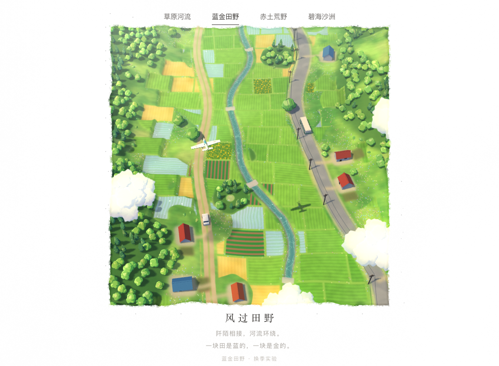
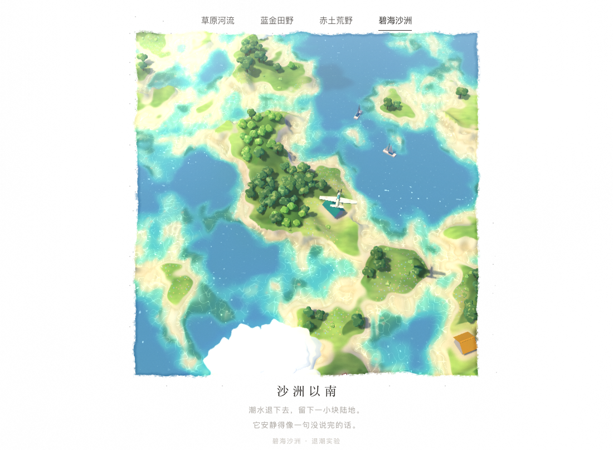

# 风过荒野 · 宫崎骏式夏天的飞行小景

**🔗 在线演示：<https://cswfww123.github.io/wind-fields/>**

（鼠标移进画面接管飞机；左键顺时针翻滚、右键逆时针；顶部标签或左右方向键切场景；
`?scene=river|fields|desert|sea` 直接打开某个场景，默认赤土荒野）



| 草原河流 | 蓝金田野 | 赤土荒野 | 碧海沙洲 |
| --- | --- | --- | --- |
|  |  |  |  |

手写 WebGL（Three.js）做的治愈系飞行场景：斜俯视的 2.5D，地面有起伏，树、房子、云都是立体的，
远处一层薄薄的空气透视，画框仍是撕纸边。四个场景共用同一套管线，只换地貌函数、色板、植被和小物件。

它最初是照着参考站复刻的**俯视撕纸画面**（那段过程留在文末），后来改成现在这样：
宫崎骏动画里那种夏天 —— 又真实又像画，镜头慢慢地、懒懒地往前推，看着让人放松。

```bash
cd wind-fields
npm install      # 依赖只有 three
npm start        # http://127.0.0.1:5199
```

---

## 画面是怎么做的

### 镜头：斜俯视，慢慢往前推

- 透视相机，俯仰 **52°**，离焦点 **158**，半视场 **15.5°**。先渲染进一张正方形离屏目标
  （比纸窗大 6%，留给撕纸毛边），再由合成 pass 贴上页面。
- 前进速度在 4.0 附近「呼吸」：`4 × (1 + 0.14·sin(0.09t) + 0.06·sin(0.23t+1))` —— 一阵快一点、一阵慢一点。
- 镜头横向慢慢跟着飞机（跟 0.6 倍、最多偏 ±14），另加很轻的偏航 / 俯仰 / 距离摆动和 0.7° 侧倾，像手持。
- 飞机在 **46** 的高度沿 S 形航线飞，转弯时压坡度，每 18–42 秒自己滚一圈（3 秒）。

### 地面：一个 GLSL 函数画一整块夏天

每个场景就是一个函数 `Ground biome(vec2 p)`：给一个世界坐标，它返回这一点的高度、底色、水、
树林密度、村落、野花、风向…… 切场景时在 GPU 上把整块世界（**160 × 256** 单位）烘成四张图：

| pass | 分辨率 | 内容 |
| --- | --- | --- |
| 布局 | 2 px/单位（320×512） | 16 位高度、水、地类（另有一位树种开关） |
| 密度 | 2 px/单位 | 树林、针叶比例、村落、孤树。读回 CPU，按它摆房子、树、果园、牛羊、船 |
| 遮罩 | 4 px/单位（640×1024） | 风、水、岸浪、水深 |
| 上色 | 12 px/单位（1920×3072） | 底色 × 天光/阳光，再叠上 Canvas2D 画的院坪、菜园、小径 |

上色结果过一遍 **8 扇区 Kuwahara**（油画/水彩那种一块一块的笔触），撒野花、加颗粒，
得到一张带 mipmap 的地面贴图。各 pass 分条渲染，一次切换 **50–300 ms**（首次编译着色器约 1 秒）。

### 实时叠加

一张跟着镜头走的网格（**150 × 230**，格距 0.8）：顶点按高度图抬起来；片元里叠真实阴影贴图
（树、房子、飞机）、云影、风吹草浪、水面涟漪 / 焦散 / 粼粼波光 / 岸边白浪，最后是雾。

### 世界是个环

z 方向以 **256** 为周期：所有噪声在 z 上都是周期的，河、路、渠都是整数圈数的正弦和，
所以烘出来的贴图首尾相接。树和房子按 **32 单位分块**，每块每帧挪到离镜头最近的那个周期副本；
镜头走过半个周期（约 30 秒）时，镜头、飞机、云、车、船一起平移 256。可以一直往前飞，看不到接缝。

### 立体的小东西

- **树**：扰动过的 icosphere 叶团拼成阔叶 / 针叶 / 伞松 / 灌木四种形状，实例化；
  三段色阶 + 噪声叶团凹凸 + 逆光描边 + 真实阴影 + 云影 + 随风轻摆。
- **房子 / 车 / 牛羊 / 帆船 / 电线杆**：一种平涂材质（面法线 + 冷暖光 + 真实阴影 + 云影 + 雾）。
- **云**：每朵约 15 个球形 impostor（billboard 写深度）拼成的立体积云，三色明暗、底部压暗、边缘透光。
  按「云顶高度」摆放（底 = 顶 − 1.6R），所有云顶都在 **43** 以下，而飞机在 46 ——
  **它永远飞在云的上面**，两者不做碰撞交互。云影沿太阳方向投到地面上。

### 四个夏天

| 场景 | 地貌 | 小物件（实测一屏内） |
| --- | --- | --- |
| **草原河流** | 清得见底的河、内弯的白砾石滩、河里的大石头、河畔林、野花草甸 | 2693 棵树 / 13 户人家 / 34 头牛羊，土路、木桥、菜地 |
| **蓝金田野** | 龙猫式里山：谷底一格格稻田（几块刚灌水的映着天）、坡脚梯田、金黄麦田和向日葵、石砌水渠 | 3182 棵树 / 20 户人家，柏油路上的巴士、路边一溜电线杆、镇守之森、杉树林 |
| **赤土荒野** | 一级级赤土台地（崖面露出岩层）、台上的干草和伞松、白沙干河床里一线细水和几汪水潭 | 1782 棵树 / 22 户人家 / 18 只羊，橄榄园梯田、葡萄园、红土路边一溜柏树、赤陶瓦农舍 |
| **碧海沙洲** | 退潮的浅海：白沙滩、淡色石崖的小岛、浮出水面的沙洲、看得见沙纹和海草的浅水，越往外越蓝 | 426 棵树 / 6 户人家 / 8 张帆，黑松与阔叶林、白墙彩顶的房子 |

### 性能

在 1500 × 1100、Apple Silicon + Chromium 上实测：四个场景都稳定 **60 fps**；
鼠标接管、左右键翻滚、方向键与标签切场景都正常；来回切八次后 GPU 上的几何体 / 贴图数量不变，没有泄漏。

---

## 文件结构

```
index.html             画面外的一切：导航、标题、字体、留白
src/main.js            渲染器、透视相机、灯光与阴影、合成、输入、场景切换、动画循环
src/flight.js          镜头推进（Rig）+ 飞机航线、鼠标接管、翻滚
src/world.js           一个场景的全部内容：烘焙 → 摆放 → 上色 → 建网格 / 树 / 房 / 车 / 船 / 云
src/scenes.js          四个场景的配置：地貌函数、曲线、色板、植被、房子、车、云、雾、文案
src/biome_*.js         四个地貌函数（GLSL）+ 河 / 路 / 渠的曲线参数
src/biome_common.js    地貌共用：Ground 结构、地类编码、草地底色、田块网格
src/bake.js            GPU 烘焙（分条渲染、读回、mipmap）
src/bake_shaders.js    烘焙着色器 + Kuwahara 上色滤镜
src/field.js           高度图解码（GLSL）+ CPU 端采样器
src/placement.js       按密度图摆房子、树、果园、牛羊、帆船
src/overlay.js         院坪 / 菜园 / 小径的 Canvas2D 叠加图
src/terrain.js         实时地形网格（跟着镜头走）+ 水面、阴影、雾
src/flora.js           树的实例化渲染与着色
src/flora_geo.js       生成树冠几何
src/props.js           房子、车、牛羊、帆船、电线杆
src/props_geo.js       生成它们的几何
src/clouds.js          球形 impostor 的立体积云
src/clouds_flat.js     一张贴片画的 2D 云（旧做法，`?clouds=flat` 可以看）
src/cloud_shaders.js   两种云的着色器
src/composite.js       撕纸画框 + 泛光 + 夏日调色
src/shading.js         共用光照：阴影贴图、云影、阵风、雾
src/noise.js           z 方向周期性的噪声
src/curves.js          整数周期的曲线
src/config.js          常量（周期、太阳、云数…）
src/airplane.js        程序化飞机模型
serve.py               本地预览服务器（npm start）
shot.mjs / shot-all.mjs  无头浏览器截图（调试用）
```

## 想改的话

- **换配色 / 文案**：`src/scenes.js` 里每个场景的 `flora.palettes`（树的四段色阶）、`houses.walls / roofs`、
  `clouds.lit / shade / deep`、`fog`、`grade`、`lines`。
- **地貌**：`src/biome_*.js` 的 `biome(p)`。河、路、渠在同文件的 `*Curves` 里，每项 `[k, 振幅, 相位]`，
  `k` 是每 256 单位的整数圈数 —— 必须是整数，世界才能首尾相接。
- **树更密 / 更疏**：`biome(p)` 里的 `g.tree`；尺寸在 `flora.forest / lone / bush / conifer`。
- **房子多少**：`biome(p)` 里的 `g.village` 和 `houses.cell`（格子越小，试放得越多）。
- **镜头**：`src/flight.js` 的 `pitch / dist / halfFov / base`（俯仰、距离、半视场、基础速度）。
- **云**：`clouds.count / size / top`（数量、半径范围、云顶高度范围；大云自然坐得低些）。
- **飞机高度**：`src/flight.js` 的 `PLANE_Y`（要一直保持在云顶之上）。

---

## 本地运行

```bash
npm install       # 只装 three
npm start         # http://127.0.0.1:5199
```

`npm start` 跑的是 `serve.py`：页面有 30 来个 ES module 同时请求，`python -m http.server`
默认的 listen 队列只有 5，实测三次里有一次会被重置连接、白屏，所以换成了队列 128 的版本。

需要 Node 18+。ES module + importmap 直接从 `vendor/three` 取包，所以**必须用本地服务器打开**，不能直接双击 `index.html`。

`shot.mjs` / `shot-all.mjs` 是无头浏览器截图脚本（依赖 `playwright-core`），
里面写死了本机 Playwright 的 Chromium 路径，换机器要改一下 `EXEC` 常量。
用法：`node shot.mjs out.png 7000 "?scene=fields"`；`node shot-all.mjs` 依次截四个场景并报帧率。端口用 `PORT=` 改。

## 部署

页面**自包含**：`three` 的最小化构建放在 `vendor/three/three.module.min.js`，`index.html` 的 importmap 指向它。
所以运行时不依赖 `node_modules`，任何静态托管都能直接跑（GitHub Pages / Cloudflare Pages / Vercel / Netlify 都行）。

**GitHub Pages**（已部署，从 `main` 构建）：
<https://cswfww123.github.io/wind-fields/>

```bash
git push origin main        # Pages 会自己重新构建，等一两分钟
gh api repos/cswfww123/wind-fields/pages/builds/latest --jq .status
```

---

## 附：从俯视复刻到 2.5D（过程记录）

这一节是旧版本的记录，数字和做法都是当时的，留作对照。

**最初**：照着参考视频复刻一张「会动的画」—— 正交俯视相机（`up = (0,0,-1)`）一路向北推，
地面是 Canvas2D 逐层画出来的 2048² 贴图（底色 + 三层色斑 + 几千笔短笔触 + 颗粒），
树是贴着贴图画的树冠实例，云是一片 quad 加片元里的 fbm，外加一个后期 pass 做撕纸边。

对着视频逐帧量出来的比例（当时）：

| 物件 | 参考视频 | 当时做的 | 现在 |
| --- | --- | --- | --- |
| 公路宽 | ~5 单位 | 5.0 | 按场景各画 |
| 车长 | ~3.5 单位 | 3.6 | 3.6 |
| 飞机翼展 | ~4.7 单位 | 4.8 | **6.4**（画面里看得清） |
| 树冠 | 2.6–5 单位 | 2.4–5.3 | 按树种 1.5–5 |
| 镜头推进 | 11.2 单位/秒 | 5.6（刻意放慢） | 4.0 上下「呼吸」 |

飞机模型（`src/airplane.js`）来自 `threejs-island-plane.zip`：纯 Three.js 几何体拼的单引擎螺旋桨飞机 ——
机身胶囊体 + 梯形主翼 + 尾翼 + 青色座舱罩 + 舷窗 + 机翼条带 + 会转的螺旋桨 + 简化起落架。
模型机头朝 +Z，本项目约定机头朝 −Z，所以外面套了一层 `holder` 并把内层 `rotation.y = Math.PI`。

后来为什么改成 2.5D：俯视版好看但平，云是贴片、树是画的，镜头一动就露馅；
于是把「地面画一张贴图」的做法保留下来（只是从 Canvas2D 换成 GPU 上的 GLSL 烘焙 + Kuwahara），
其余全部换成有厚度的东西：地形网格、立体的树和房子、球形 impostor 的积云、真实的阴影贴图。
中间还踩过几个坑：时间周期的接缝（云、树摆、水面噪声都要整数周期）、
云和飞机的交互（推力相加会「炸开」，改成取最强航迹点才好），最后干脆把飞机抬到云顶之上、不再做交互。